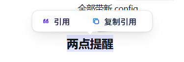

# dsh-quote-selection

> ⚡ 为 DeepSeek Harness (DSH) 打造的划词引用与复制悬浮工具条，支持 `Ctrl/Cmd + L` 快捷插入。

[](package.json)
[](LICENSE)
[](https://github.com/Adingo001/dsh-quote-selection)

<p align="center">
  
</p>

---

## 📖 简介

在 DeepSeek Harness 对话中选中任意文本，即可自动唤起浮动工具条：
- **「“ 引用」**：自动将所选内容以 Markdown 引用块（`> ...`）格式追加至底部输入框，并将焦点平滑定位至编辑区。
- **「⧉ 复制引用」**：直接将格式化后的 Markdown 引用文本写入剪贴板，伴随状态反馈动效。
- **快捷键 `Ctrl/Cmd + L`**：选中文本后按下快捷键，可直接一步完成引用插入。

---

## ✨ 核心特性

- **🚀 零感知唤起与自适应定位**
  - 选中对话内容自动居中浮现于选区上方；当顶部空间不足时自动智能翻转至选区下方。
  - 智能作用域过滤：自动忽略输入框、按钮、链接内部的选区操作，按 `Esc`、点击外部或滚动页面自动隐去。
  - 超长文本保护：单次选区超过 4000 字符时自动截断并追加省略号，防止巨型文本卡顿。

- **🎨 精致视觉与微动效设计**
  - **毛玻璃质感**：多重微阴影、内高光结合 `backdrop-filter` 磨砂玻璃材质，完美融入应用。
  - **Tabs Sliding 滑块交互**：鼠标在「引用」与「复制引用」之间移动时，背景交互药丸提供丝滑平移吸附效果。
  - **边框动态光轨 (Border Beam)**：1px 边框内嵌动态渐变跑马灯光晕，支持光标悬浮加速。
  - **自适应深浅主题与减弱动画支持**：适配浅色/深色模式；支持 `prefers-reduced-motion` 自动降级无障碍体验。

- **🧩 深度兼容 Lexical 编辑器**
  - 严格按照光标设置 $\rightarrow$ 聚焦 $\rightarrow$ 帧同步调度 $\rightarrow$ 写入验证的流程操作，兼具 `beforeinput` / `paste` 多重降级保障。

---

## 🚀 快速上手

### 安装

确保你的机器上已安装并配置好 DeepSeek Harness CLI：

```bash
# 从 GitHub 安装（将 desktop 替换为你实际使用的 profile 名称）
dsh plugin --profile desktop add -w github:Adingo001/dsh-quote-selection
```

> [!IMPORTANT]
> **安装后请重启 DeepSeek Harness**。本插件依赖宿主启动阶段的注入表快照收集，重启后即可全面生效。

### 本地开发安装

```bash
# 本地软链接至开发目录
dsh plugin --profile desktop add link:/path/to/dsh-quote-selection
```

### 卸载

```bash
dsh plugin --profile desktop remove dsh-quote-selection
```

---

## 💡 使用指南

| 交互动作 | 触发方式 | 说明 |
| :--- | :--- | :--- |
| **浮出工具条** | 鼠标划选对话文字 | 自动在选区上方/下方居中呼出 |
| **插入引用** | 点击 **「“ 引用」** 或按 **`Ctrl/Cmd + L`** | 将选区转为 `> 内容` 追加到输入框末尾并聚焦 |
| **复制引用** | 点击 **「⧉ 复制引用」** | 写入剪贴板，按钮切换为「✓ 已复制」并在 1.5s 后自动收起 |
| **退出/关闭** | 按 **`Esc`** / 点击页面任意处 / 滚动窗口 | 立即收起工具条 |

---

## 🔬 技术实现细节 (Under the Hood)

<details>
<summary><b>1. 为什么采用宿主索引注入 (index-inject) 而非 <code>dsh.client</code>？</b></summary>
<br>

DSH 0.2.x 桌面端仅对 `dsh.client` 声明进行预取（`prefetchImmediateTier`），只有在被其他模块显式 `import` 时才会真正执行。纯 UI/DOM 增强型插件缺少调用方，会导致模块无法 materialize。
因此，本插件改走 **宿主索引注入（Host Index Injection）** 机制：
```text
index.js  →  ctx.on('webserver/index-inject', rows => rows.push({ kind: 'script', text, placement: 'body' }))
          →  宿主 collectIndexInjections() 收集（启动阶段）
          →  桌面端通过 boot IPC 接收并执行；Web 端直出 index.html
```
该机制在应用层前端挂载前完成注入，完全解耦客户端模块依赖图。
</details>

<details>
<summary><b>2. Lexical <code>contenteditable</code> 编辑器写入兼容</b></summary>
<br>

底层输入框基于 Lexical 实现，其仅在获得真实焦点时才会同步 DOM 选区。插件按严格的时序执行写入调度：
1. 预设光标位置至末尾；
2. 触发编辑区 `focus()`；
3. 延迟两个动画帧以确保状态同步；
4. 调用 `execCommand('insertText')`，并通过比对 `textContent` 校验有效性；若校验失败则平滑降级至 `beforeinput` / `paste` 事件模拟。
</details>

---

## 🧪 测试与自检

运行单元测试（覆盖引用格式化、长文本截断、边界检测规则）：

```bash
npm test
```

> **浏览器端自检**：每次页面加载时，脚本会在 `localStorage` 中写入 `dsh-quote-selection:selftest` 诊断信息，便于随时排查工具条挂载状态与 DOM 节点情况。

---

## 📄 开源协议

本项目基于 [MIT](LICENSE) 协议开源。
